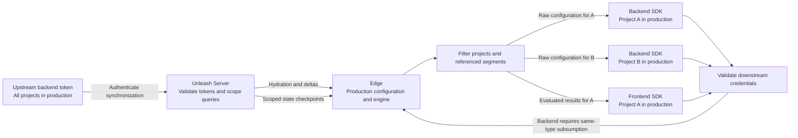
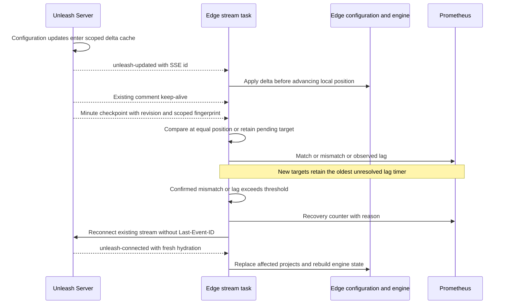

# Streaming state consistency and token scoping

This experiment verifies an Edge replica against its connected Unleash Server
pod without polling snapshots. Server sends an `unleash-state` checkpoint on the
existing SSE connection approximately once a minute. Edge detects lag or a
confirmed configuration mismatch and requests fresh hydration by reconnecting
without a replay cursor. SSE comment heartbeats continue every 30 seconds.

Both sides are opt-in: set `EDGE_STATE_CHECKPOINTS=true` on Server and Edge.
Edge's optional positive integer `EDGE_STATE_LAG_THRESHOLD_SECONDS` defaults to
30. Invalid values use 30. Recovery is limited to once per minute per stream.
There are no new endpoints, database writes or scheduled snapshot HTTP requests.
Recovery replaces an existing streaming connection with another connection to
the same endpoint.

## Existing token and synchronization architecture

There are two distinct token roles. **Upstream backend tokens** authenticate
Edge's configuration synchronization. **Downstream SDK tokens** authenticate
requests to Edge and determine which cached features or evaluation results they
can access. An Edge deployment can synchronize multiple scopes and environments.

Server authenticates backend token secrets, expiry and token kind through
[`backendApiAccessMiddleware`](https://github.com/Unleash/unleash/blob/master/src/lib/middleware/backend-token-middleware.ts).
Legacy/v2 token services resolve authoritative projects, environment and type.
Token prefixes alone are not authorization: Edge initially parses them into an
Unknown token and validates them upstream. Server's
[`EdgeService.getValidTokens`](https://github.com/Unleash/unleash/blob/master/src/lib/services/edge-service.ts)
returns each credential's scope; it does not authorize one credential by another.

Server's query resolution overrides requested projects and environment with
restricted token scope. Wildcard project scope permits query selection. Name
prefixes and segment capability also affect the payload. Configuration is
environment-specific; frontend context then determines evaluated results.

Edge's [`TokenValidator`](../crates/oss/unleash-edge-auth/src/token_validator.rs)
validates and caches downstream credentials independently of synchronization.
[`validate_token`](../crates/oss/unleash-edge/src/middleware/validate_token.rs)
gates backend tokens to client routes and frontend tokens to frontend/proxy
routes. The startup revalidation task registers and hydrates configured tokens.
The inspected downstream request path validates new tokens but does not itself
automatically add them to the upstream refresh set.

[`EdgeToken::subsumes`](../crates/oss/unleash-edge-types/src/tokens.rs) requires
equal token types, exactly equal optional environments, and either project `*`
or a covering project list containing every requested project (with at least
the requested list's length). It does not check validity or expiry itself.
Environment `*` is not a hierarchy in that comparison. `simplify` reduces the
refresh set, first deduplicating by project vector and environment without type;
it should not be treated as a general-purpose authorization framework.

Backend serving uses validated scope in
[`resolve_features`](../crates/oss/unleash-edge-client-api/src/features.rs),
[`features_for_filter`](../crates/oss/unleash-edge-feature-refresh/src/lib.rs)
and [feature filters](../crates/oss/unleash-edge-feature-filters/src/lib.rs).
Backend coverage additionally requires subsumption by an active refresh token.
Frontend serving reads the environment engine and filters evaluated toggles by
validated project scope in
[`frontend_from_yggdrasil`](../crates/oss/unleash-edge-frontend-api/src/lib.rs).
The separate frontend coverage helper omits type equality, but its only call
site in the inspected baseline is a test. Do not infer that the live frontend
path enforces the backend subsumption check.

The [feature cache](../crates/oss/unleash-edge-feature-cache/src/lib.rs) is keyed
by environment, falling back to the raw token if environment is absent. Multiple
upstream scopes can contribute to that cache. Narrow full updates replace their
projects and retain other projects; segments are merged. Overlapping scopes can
overwrite each other's features, and even disjoint projects can share segments.
Token revalidation and data retention are separate: successful revalidation
marks missing credentials Invalid, whereas a failed validation request does not
invalidate every cached token. Forbidden refreshes remove the upstream token and
remove the environment caches only when no refresh token for it remains.
Revocation is therefore eventually observed through Server token caches and
Edge revalidation, not established by a configuration hash.



The broad upstream token covers both backend SDK tokens. It does not subsume the
frontend token through the same-type function: the frontend credential is
authenticated independently. A staging token cannot use the production cache.
Hashing the entire Edge process would mix environments, and hashing its entire
environment cache against a narrow upstream token could compare A+B against A.
The comparison must use the upstream connection's effective scope.

## Checkpoint protocol and fingerprints

Server's synchronous `ClientFeatureToggleDelta.getStateCheckpoint` reads the
existing delta hydration snapshot and token-scoped visible revision in one
execution without awaiting or initializing a cache. It uses the same project
and name-prefix filtering as synchronization. The streaming service sends:

```text
event: unleash-state
data: {"version":1,"revision":1234,"stateHash":"<64 lowercase hexadecimal characters>"}

```

There is deliberately no SSE `id`. Checkpoints must not advance `Last-Event-ID`
past data Edge has actually applied. The revision watermark is at least the
last revision already sent on that connection: unrelated segment-removal events
can otherwise put the delivery cursor beyond the scope's visible revision.
This watermark adds no new configuration and is not a database freshness claim.

Version 1 hashes SHA-256 over UTF-8 stable JSON of evaluation configuration:

- Features sorted by UTF-8 name, containing name, enabled, project, impression
  data, strategies, variants and dependencies.
- Referenced segments only, sorted by numeric ID, containing ID and constraints.
- Object keys sorted by UTF-8 bytes. Nested array order remains significant.
- Null, absent and empty-array object fields normalize alike. Impression data
  defaults to false; absent/false constraint inversion and case flags normalize.

Feature/segment display metadata, transport metadata, ETags and revisions are
excluded. Server and Edge have identical golden fixtures exercising optional
fields, numeric parameter keys, Unicode, segment references and typed Rust
roundtrips. This is a small versioned representation, not a general JSON
canonicalization standard. Hash functions live in Server `delta/stream-state.ts`
and Edge [`stream_state.rs`](../crates/oss/unleash-edge-feature-refresh/src/stream_state.rs).

## Moving targets and recovery

Edge tracks the applied SSE position per upstream stream, after configuration
and engine application completes. It retains pending checkpoints with monotonic
receipt times. New targets or repetitions do not restart the oldest unresolved
timer. Applying a revision retires checkpoints at or below that position; a
fingerprint is compared only at an equal position. A fingerprint older than
local state is never compared to newer contents. If application jumps past a
checkpoint, revision convergence is observed but content agreement is unknown
until another comparable checkpoint arrives.

For example, Edge is at revision 10. Checkpoint 11 arrives at t=0 and checkpoint
12 at t=10. Edge applies 11 at t=15, so the oldest remaining lag starts at t=10.
Checkpoint 13 at t=20 does not reset it. If 12 remains unapplied at t=40, its
30-second threshold is crossed despite the target continuing to move.



Recovery discards the EventSource client itself, clearing its internal cursor as
well as Edge's cursor. Ordinary idle/transport reconnections continue to preserve
the last applied cursor. Recovery waits the existing five-second reconnect delay
and can occur at most once per minute per stream. New connections clear pending
targets because their Server pod and revision baseline may differ. Recovery
retains its cooldown across those connections. Failed or unsupported checkpoint
messages do not trigger recovery.

Fresh scoped hydration preserves other projects sharing the environment. Its
combined environment snapshot updates the downstream delta cache and engine;
empty hydration is supported. **Content verification currently requires one
active upstream refresh token per environment.** With multiple upstream streams
sharing features or segments, local content can be newer than an individual
stream's position. Edge reports content verification unknown instead of claiming
a confirmed mismatch. Per-stream lag detection still works. Many narrower
downstream SDK tokens covered by one broad upstream token remain supported.

## Metrics and practical limits

Metrics have only fixed result/status/reason labels, with no tokens, projects,
revisions or hashes in labels:

| Metric | Meaning |
| --- | --- |
| `edge_stream_state_scopes{status}` | Active monitored streams by last status: unknown, matched, lagging or mismatching |
| `edge_stream_state_checks_total{result}` | Match, mismatch, behind, stale, invalid or unsupported observations |
| `edge_stream_state_lag_seconds` | Histogram of oldest unresolved checkpoint age, sampled each second |
| `edge_stream_state_convergence_seconds` | Histogram of receipt-to-applied-position duration, including jumps past a target |
| `edge_stream_state_mismatch_duration_seconds` | Histogram from first confirmed content mismatch until a verified match, across recovery reconnects |
| `edge_stream_state_recoveries_total{reason}` | Fresh-hydration requests due to mismatch or threshold-exceeding lag |

Status means the last verification result, not an assertion about every later
change. Checkpoints older than 120 seconds make status unknown. No checkpoint
from an older Server also remains unknown; SSE comments alone do not verify
state. Invalid includes unavailable/ambiguous local scope. Pending targets are
bounded to 64, preserving the oldest target if the bound is reached. Restart
resets timers and metrics. Pauses and long processing delays affect observations.

A 30-second threshold measures time **since checkpoint receipt**, not since the
original Server change. Minute checkpoints cannot promise a 30-second change-to-
convergence SLA. The existing 30-second heartbeat scheduler also quantizes the
first checkpoint's emission time. Missing checkpoints expose uncertainty, not
proof that the last verified state remains current.

Agreement establishes modeled configuration equality against the connected pod's
delta cache. It does not establish that every Server pod has caught up with the
database, that the database is available, that evaluation compiled successfully,
or that SDK clients received the result. Existing compilation-warning metrics
remain necessary. Server's cache can be stale while both sides agree. A future
authoritative revision watermark could expose this additional failure mode.

Older Edge consumers ignore the new named event (some versions log unknown
events). Older Servers send no checkpoints. Unknown protocol versions are
ignored. Unknown future evaluation fields may require a new fingerprint version;
incompatible representations must not silently share version 1. Recovery cannot
repair a persistent Server bug or a representation disagreement, hence the
cooldown and opt-in rollout. Fingerprinting costs serialization and hashing per
connection per minute on Server and at comparable checkpoints on Edge.

This MVP verifies direct Server-to-Edge streams. Edge-to-Edge relays do not emit
or preserve origin checkpoints yet, so end-to-end verification through a relay
is unknown. Next iterations should measure canary mismatch/recovery frequency,
cache fingerprints per effective scope if CPU cost warrants it, and address
multi-upstream shared-environment revision tracking before expanding coverage.
