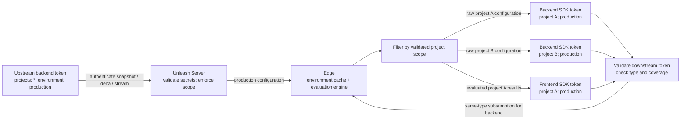

# Token scoping and state propagation

This describes the inspected Server and Edge implementation, then the optional
consistency experiment. Upstream synchronization tokens and downstream SDK tokens
are separate roles; an Edge deployment need not have exactly one upstream token.

Source baseline: Edge `890d4ea213302cc20b0132890e0e3eb0698c776a` and Server
vendored in unleash-enterprise `4dc72b812b39fe41d2be2c2fb6089c5c7442a45e`
(`oss/`). Source links below name the relevant functions; recheck behavior when
using a different revision.

## Existing architecture

### Server authorization and effective scope

Server backend API tokens carry a token type, projects and an environment.
`*` grants all projects. Multiple projects are represented by the validated
project list, not reliably by parsing the token prefix. The prefix is only an
initial hint in Edge: `EdgeToken::from_trimmed_str` produces an **Unknown** token.
Validation returns the authoritative type, environment and projects.

Server authenticates the secret (including expiry), with distinct handling for
legacy and v2 tokens. Admin, personal and service-account credentials are not
interchangeable with backend data tokens. In particular,
[`backendApiAccessMiddleware`](https://github.com/Unleash/unleash/blob/master/src/lib/middleware/backend-token-middleware.ts)
checks token kind and type; legacy middleware behavior is flag-dependent.
[`ApiTokenService`](https://github.com/Unleash/unleash/blob/master/src/lib/services/api-token-service.ts)
maintains active-token caches, so revocation is not an instantaneous distributed
operation.

[`ClientFeatureToggleController.resolveQuery`](https://github.com/Unleash/unleash/blob/master/src/lib/features/client-feature-toggles/client-feature-toggle.controller.ts)
overrides project and environment query parameters with restricted token scope.
Wildcard scope permits query selection. `namePrefix`, tags and segment capability
also affect the representation returned by the client API; they do not broaden
token authorization. Segment-capable responses contain active segments, including
segments not referenced by the selected features. Older clients receive inlined
segment constraints instead.

[`EdgeService.getValidTokens`](https://github.com/Unleash/unleash/blob/master/src/lib/services/edge-service.ts)
returns validated token metadata through the existing Edge validation API. This
validates the submitted tokens individually; it does not prove one token subsumes
another. Edge performs coverage checks locally. Server also has an Edge-issued
token path (`getOrCreateTokens`) requiring the configured Edge master secret;
this is separate from ordinary backend snapshot synchronization.

### Edge authentication, coverage and serving

Edge sends an upstream backend token in its configured authorization header when
fetching configuration. See
[`UnleashClient::client_features_req`](../crates/oss/unleash-edge-http-client/src/lib.rs).
Configured startup tokens seed synchronization. The startup revalidation task
registers and hydrates them after validation; the refreshers expose registration
methods that simplify the set. In the inspected request path, encountering a new
downstream token validates it but does not automatically register a new upstream
refresh. Do not equate the refresh set with one fixed deployment credential.

Downstream SDK tokens are independently validated and cached by
[`TokenValidator`](../crates/oss/unleash-edge-auth/src/token_validator.rs).
[`validate_token`](../crates/oss/unleash-edge/src/middleware/validate_token.rs)
rejects invalid/unknown tokens and gates backend tokens to client API routes and
frontend tokens to frontend/proxy routes. Possessing data for a project does not
authenticate a downstream credential.

[`EdgeToken::subsumes`](../crates/oss/unleash-edge-types/src/tokens.rs) requires:

1. Equal token types, including equality of the optional type values.
2. Exactly equal optional environments; `*` is not an environment hierarchy here.
3. The covering token has project `*`, or contains every requested project
   (and its project-list length is at least the requested length).

It does **not** check token validation status or expiry. Callers must establish
validity separately. Two backend tokens with the same effective scope can cover
each other regardless of secret identity. A backend token does not subsume a
frontend token through this function. The separate
[`frontend_token_is_covered_by_tokens`](../crates/oss/unleash-edge-feature-refresh/src/lib.rs)
helper intentionally uses only the environment/project relation for frontend data
coverage. In this revision its only call site is a test; the live frontend serving
path reads the environment engine and filters evaluated projects, without that
explicit refresh-token coverage check. Do not infer a live authorization guarantee
from the helper, or substitute it for credential authentication.

`simplify` reduces the refresh set by scope. Its uniqueness key is the project
**vector** and environment, without token type, while `subsumes` includes type.
This implementation detail matters when reasoning about mixed token types or
different project ordering; the set is not a generic authorization lattice.

[`FeatureCache`](../crates/oss/unleash-edge-feature-cache/src/lib.rs) is keyed by
environment (falling back to the raw token when environment is absent). Full
updates replace features for the refreshing token's projects and retain other
projects. Wildcard updates replace the feature list. Segments are merged and
deduplicated. Partially overlapping scopes can have independent refreshes; the
last applied update determines the overlapping project's contents. There is no
separate feature snapshot per token.

Backend requests use validated scope and
[`get_feature_filter`](../crates/oss/unleash-edge-client-api/src/features.rs) /
[`filter_client_features`](../crates/oss/unleash-edge-feature-filters/src/lib.rs)
to select projects, optional name prefix, and referenced segments. The polling
[`features_for_filter`](../crates/oss/unleash-edge-feature-refresh/src/lib.rs)
path additionally checks coverage by an active refresh token. The client API uses
that same function with either the polling or streaming refresh set.
Frontend requests evaluate the environment's engine with SDK context, then filter
resolved toggles by validated project scope in
[`frontend_from_yggdrasil`](../crates/oss/unleash-edge-frontend-api/src/lib.rs).
Frontend responses are evaluated results, not raw configuration snapshots.

Periodic revalidation marks missing downstream tokens Invalid. Failed validation
requests do not invalidate every cached token. A forbidden polling refresh removes
that upstream token; the environment feature/engine cache is removed only when
no refresh tokens for that environment remain. Thus retained cache contents and
currently authorized access are different concepts. Revocation visibility is
bounded by successful Server cache refreshes, Edge revalidation and upstream
requests, not by this consistency experiment. Offline/trusted-token modes bypass
parts of this online flow.



The frontend token is independently authenticated; its data can be covered by
the broad backend token without satisfying same-type `subsumes`. A staging token
cannot use the production cache. Without the wildcard token, tokens for A and B
can populate the same production cache through separate refreshes.

### Propagation and revisions

Full polling uses conditional GET with ETags. Server `calculateMeta` constructs
the ETag from a query hash, environment revision and representation version; it
is **not a content checksum**. Revision metadata and the feature/segment payload
are read separately, so that response is not guaranteed to be an atomic database
snapshot. Revision equality alone does not establish content equality.

Enterprise delta/streaming uses hydration and incremental events; see
[`DeltaRefresher`](../crates/oss/unleash-edge-feature-refresh/src/delta_refresh.rs)
and [Server delta cache](https://github.com/Unleash/unleash/blob/master/src/lib/features/client-feature-toggles/delta/delta-cache.ts).
Full updates and deltas update the feature cache and evaluation engine. Network
delays, poll intervals, event delivery, backoff and reconnect/hydration produce
temporary differences. Existing synchronization already retries and hydrates;
the experiment adds no recovery action. Existing compilation-warning and revision
metrics are described in [feature refresh metrics](feature-refresh-metrics.md).

## Experimental consistency audit (implemented)

The authoritative expected configuration is the response of the existing
`GET /api/client/features` endpoint authenticated by each **active refresh
token**, without an ETag. Edge hashes that response and a local projection for
the same token. Server needs no change: it already calculates and filters the
expected state. Both SHA-256 calculations run in Edge over the same typed model,
avoiding a new cross-language serialization contract.

The licensing heartbeat is unsuitable for this MVP: it runs every 90 seconds and
[`find_first_valid_token`](../crates/enterprise/unleash-edge-enterprise/src/lib.rs)
selects one arbitrary backend token, not every refresh scope. SSE keepalives are
transport liveness, not scoped state attestations. This implementation deliberately
trades extra snapshot bandwidth for no endpoint, schema, migration or heartbeat
change. If compact Server-generated hashes become necessary, propagate one per
effective refresh scope, not one hash for the entire Edge process.

The fingerprint contains token-selected features sorted by name and their
referenced segments sorted by ID. Object keys are sorted recursively; nested
array order remains intact. Query, meta and top-level protocol version are
excluded. An unreferenced segment cannot affect these features and is excluded.
Empty segment collections normalize to an empty list. Empty project scopes or
missing environments are reported as audit errors, rather than matching two empty
projections. Some serving filters treat empty projects as unrestricted; this audit
requires explicit validated scope.

```mermaid
sequenceDiagram
    participant S as Unleash Server
    participant R as Existing Edge synchronization
    participant C as Edge feature cache
    participant A as Read-only audit
    participant M as Prometheus
    S->>S: Configuration changes
    par Normal propagation
        S-->>R: Snapshot / delta / stream event
        R->>C: Apply configuration
    and Independent audit
        A->>S: Existing snapshot GET with active refresh token
        S-->>A: Token-scoped expected configuration
        A->>A: Hash expected features + referenced segments
        A->>C: Read same environment; project to token scope
        A->>A: Hash local projection and compare
        A->>M: Match / mismatch / error
    end
    Note over A,M: Mismatch starts monotonic timer; default threshold 30 seconds
    A->>A: Later successful comparison still differs past threshold
    A->>M: Threshold episode counter; unresolved duration gauges
    R->>C: Later update converges
    A->>A: Later comparison matches
    A->>M: Record observed convergence duration; clear mismatch
```

Enable with `EDGE_STATE_CONSISTENCY_CHECK=true`. Optional positive integer
`EDGE_STATE_CONSISTENCY_THRESHOLD_SECONDS` defaults to 30. Invalid values fall
back to 30. The task checks active tokens sequentially, then waits five seconds.
It respects the existing refresh pause signal. Both polling and streaming use
the same audit. Disabling it restores the previous request volume.

Metrics use fixed labels only; no token, project, environment, revision or hash
labels are introduced:

| Metric (`edge_state_consistency_` prefix) | Meaning |
| --- | --- |
| `checks_total{result="match\|mismatch\|error"}` | Successful comparisons or unsuccessful audit requests/serialization |
| `observed_scopes` | Active refresh tokens with at least one successful comparison |
| `mismatching_scopes` | Last successful comparison differed |
| `oldest_mismatch_seconds` | Time since oldest unresolved first observed mismatch |
| `scopes_over_threshold` | Unresolved mismatch age at least configured threshold |
| `episodes_total{event="started\|threshold_exceeded"}` | Episode starts; once per episode on a successful comparison establishing duration at least threshold |
| `convergence_seconds` | Histogram from first observed mismatch until a successful matching check |

Inspect `increase(edge_state_consistency_checks_total{result="error"}[5m])`
alongside mismatch gauges: zero mismatches alone is not evidence of successful
checks. A scope removed from the refresh set loses its observation without being
counted as convergence. Process restart resets timers. An episode spans changing
expected hashes until agreement; it does not track every individual mutation.

## Guarantees, limitations and next iteration

- Equality establishes agreement of the modeled configuration at the two sampled
  reads, within SHA-256 collision assumptions. It is not a guarantee about the
  evaluation engine, every SDK response, authorization correctness, or fields
  unknown to this Edge version. Use compilation warning metrics alongside it.
- Hashing the whole environment cache would compare A+B against A for a narrow
  token. Hashing the whole process could also mix environments. Effective scope,
  not raw token identity, defines the comparable content. Observations are kept
  per active refresh credential in memory, so token rotation starts a new timer
  and overlapping refresh scopes may count the same affected project twice.
- There is no atomic Server/local snapshot. Updates during a fetch, overlapping
  refreshes and cache races can cause transient false mismatches. Revisions are
  deliberately not used to suppress content checks; an environment revision may
  change because of unrelated projects and metadata may race payload reads.
- Thirty seconds is an experimental observed-duration threshold, not a change-to-
  convergence SLA. Differences entirely between samples are missed. Fetch latency
  and token count lengthen sampling. Errors retain the last successful status;
  mismatch age continues through outages and pauses, which can overstate duration.
- Typed deserialization normalizes some missing/default values but discards unknown
  fields. Semantic-equivalent nested array reordering or absent versus explicit
  optional values may mismatch. Unsupported new Server fields can differ without
  detection. No shared canonicalization protocol or version handshake is claimed.
- Existing Server versions need no upgrade and older Edge versions are unaffected.
  The upstream may itself be Edge: then agreement is with that hop, not necessarily
  the origin Server. This is not an independent audit of Server database state.
- Cost is one full snapshot per active refresh token per cycle, two serializations,
  hashing and cache cloning. All tokens run sequentially and HTTP timeouts use the
  existing client settings. Enable on a small canary before increasing coverage.

Next, measure request cost and mismatch causes on canaries. If bandwidth dominates,
add an optional scoped hash to an existing Server response with a shared golden
fixture, and sample more cheaply. Add revision-aware timestamps only if atomic
snapshot semantics can be established. Automatic full hydration is worth testing
only after persistent content mismatches are distinguished from serialization,
overlap and engine-compilation issues; it is intentionally absent here.
